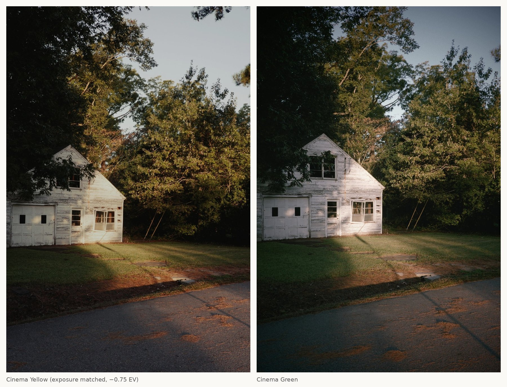
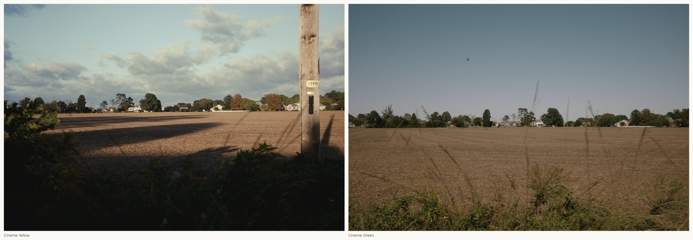

# GR IIIx Cinema Recipe + Log

Firmware mods for the **Ricoh GR IIIx** (firmware 1.60): video manual mode with a higher bitrate, a **GR-Log** profile
for grading, the GR IV's **Cinema (Yellow)** and **Cinema (Green)** looks with their Color Tone setting, and grain,
clarity and shading on those looks.

This repository holds **build scripts only**. It contains no Ricoh firmware and no data taken from it. You download
Ricoh's own update files, and `build.sh` turns them into a modified `FWDC243B.BIN` on your computer, checking every
step against a known SHA-256.

> **Use at your own risk.** Flashing modified firmware can stop a camera from booting, and there is no confirmed
> recovery method if that happens. These builds have been flashed and used on one GR IIIx (and stage 5 on an Urban
> Edition and a Diary Edition). Read [docs/FLASHING.md](docs/FLASHING.md) first, including how to go back to stock.

Most of the work here builds directly on other people's projects; see [Credits](#credits).


*Cinema (Yellow), left, vs Cinema (Green), right: same scene and light, Yellow darkened 0.75 EV to match. Shot on a GR IIIx with this build.*


*Open field: Cinema (Yellow), left, vs Cinema (Green), right (different days and light).*

## What you get (stage 11)

| Feature | Details |
|---|---|
| **Video M mode** | Turn the mode dial to M in movie mode to get manual shutter, aperture and ISO. Exposure stays fixed while you pan. Stock firmware forces P. *(judgem00's video patches)* |
| **Higher video bitrate** | 24p 42 / 30p 52.5 / 60p 52.5 Mbit/s average, with a peak of 1.5× (stock is 16.8 / 21 / 42). |
| **GR-Log on Vivid** | A flat log profile for colour grading. It records about −5.5 to +3.5 stops around middle grey at about 28 codes per stop, uses full range, and gives the same result in every scene. Vivid becomes GR-Log while this build is installed. *(based on judgem00's GR-Log)* |
| **Cinema (Yellow) / (Green)** | The GR IV's Cinema looks: colour matrix, exact tone curves and its 12 hue sectors, taken from the GR IV firmware by emulation. They replace Bleach Bypass and Retro, and also appear in movie mode and RAW development. *(idontknownihil's builder, ported to the IIIx)* |
| **Cinema Color Tone** | Cinema (Yellow): Toning `--` / blue / red = GR IV Color Tone 1 / 2 / 3. Cinema (Green): the −4…+4 slider, where ≤0 = CT1, +1/+2 = CT2 and +3/+4 = CT3. |
| **Grain, Clarity, Shading** | All three work on both Cinema looks, and Grain also works on Negative Film. Cinema (Yellow), Cinema (Green) and Negative Film share one Grain setting per settings bank. |
| **GR-Log LUTs** | `build.sh` also writes `GR-Log v2 → Rec.709` and `→ Standard` LUTs (33³ and 65³) for DaVinci Resolve. `lut-tools/` turns film-emulation LUTs into GR-Log versions. |

### Known limitations

* **Bleach Bypass, Retro and Vivid are gone** while this firmware is installed (Cinema and GR-Log take their places).
* **Cross Process** renders without its signature curves, because the Cinema data uses that storage.
* **ND filter** does not engage in video M. It works in video P/Av/Tv and in stills.
* **No shutter/aperture readout** while recording in video M. The values still apply.
* Video at the higher bitrate has been field-tested with clips of up to about 1 minute (no crashes or dropped
  recordings). Long clips (10+ min), heat and slow cards are untested. The remaining-time display uses the old bitrate.
* Highlight correction has no effect in video M. GR-Log assumes it is off.

## Camera test status

| Stage | Contents | Status on a real GR IIIx |
|---|---|---|
| 1 | Video M + 2× bitrate | ✅ M works, exposure locks, bitrate doubled · ❌ overlay readout, ND |
| 2 | Cinema (Yellow/Green) | ✅ renders correctly |
| 4 | + Clarity/Shading gate, Negative Film grain | ✅ |
| 5 | + Cinema grain | ✅ (also on an Urban Edition and a Diary Edition) |
| 8 | + Cinema Color Tone on Toning | ✅ Yellow: --/blue/red step from light to strong; Green −4…+4 not yet confirmed |
| 9 | + GR-Log on Vivid | ✅ GR-Log + LUT looks right; much cleaner shadows than Standard |
| 10a | + bitrate 52.5 Mbit/s | ✅ clips record and play back (short clips tested) |
| **11** | **+ GR-Log v2 curve** | ✅ **current build** · GR-Log + film LUT confirmed · field use: both Cinema looks in sun, backlight, shade, overcast and portraits; video clips up to ~1 min, no crashes |

Stages 6 (an ND attempt that didn't work) and 7 (superseded by 8) are left out. See [docs/TESTING.md](docs/TESTING.md)
for the measurements.

## Help test it

More testing is very welcome, especially:
* the Cinema (Green) −4…+4 Toning slider (does each step change the look?);
* long video clips (10+ min), heat, and different SD cards;
* a GR IIIx **HDF** (same firmware file, not yet flashed on one);
* GR-Log in harder light, with your own LUTs.

Open an issue with your camera, the stage hash and what you saw. Sample photos help.

## Building

You need:

* `fwdc243b.bin`: Ricoh **GR IIIx 1.60** (Ricoh's download page, GR IIIx; the same file serves the Urban Edition
  and HDF).
* `fwdc248b.bin`: Ricoh **GR IV 1.11**. It is only read, as the source of the Cinema look data.
* Python 3.10+ with `numpy pillow capstone unicorn`, a Rust toolchain (`cargo`), `git`, LLVM's `llvm-mc` (set `LLVM_BIN`
  to its folder if it isn't on your PATH), and the DejaVu Sans Condensed Bold font (set `GR3X_FONT` to its path; it
  draws the C-Y / C-G menu icons).

```sh
pip install numpy pillow capstone unicorn
./build.sh ~/Downloads/fwdc243b.bin ~/Downloads/fwdc248b.bin out
# optional, slow: VERIFY=1 ./build.sh ...   (runs the emulation checks)
```

`build.sh`:

1. checks both Ricoh files by SHA-256;
2. clones judgem00/gr3-look-editor and idontknownihil/gr3-film-mods at pinned commits into `third_party/` and
   applies the two small patches in `patches/` (the IIIx port of the film builder, plus four Rust examples);
3. extracts the Cinema data from the GR IV file into `out/work/gr4/` (`tools/extract_gr4.py`);
4. builds stage 1 → 2 → 3 → 4 → 5 → 8 → 9 → 10a → 11, packs each one and compares it with
   [`expected-hashes.txt`](expected-hashes.txt). It stops at the first mismatch;
5. writes `out/FWDC243B.BIN` (stage 11, SHA-256 `45cb3826…82a4feac`) and the LUTs in `out/luts/`.

If your result doesn't match the expected hash, **don't flash it**. Open an issue with the log instead.

Everything under `out/` and `third_party/` is ignored by git. **Don't commit or share `out/`.** It contains Ricoh
firmware and data derived from it, including the LUTs.

## Repository layout

```
build.sh                 the whole pipeline
expected-hashes.txt      SHA-256 of the inputs and every stage
patches/                 our changes to the two upstream projects (applied by build.sh)
tools/                   stage builders and emulation verifiers (stages 4–11), GR IV extractor
lut-tools/               GR-Log → Cineon / film-LUT converters, ImpulZ organizer (bring your own LUTs)
docs/                    flashing and going back, test results, how each patch works
```

## Credits

This project builds on these people's work; most of the hard parts are theirs. Thank you.

* **judgem00, [gr3-look-editor](https://github.com/judgem00/gr3-look-editor)** (MIT). The video M patches and
  bitrate patch (stage 1), GR-Log, the firmware container packer (`fw-pack.py`), the look-editor library our Rust
  examples use, and much of the image-pipeline documentation.
* **idontknownihil, [gr3-film-mods](https://github.com/idontknownihil/gr3-film-mods)** (MIT). The v16 film-slot
  builder (Cinema slots, MultiAxial hue sectors, RAW development and EXIF fixes, icons), the GR IV emulator and
  Cinema extraction method, the ARM assembler wrapper, and the FINDINGS notes that the grain, gate and Toning work
  relies on.
* **DoYitNow, [gr-custom-tool](https://github.com/DoYitNow/gr-custom-tool)** (GPL-2.0). The firmware container codec
  (`gr4_editor`), used at build time through gr3-film-mods. It is fetched by `build.sh` and not included here.
* **hhornbacher, [gr3x-fw-hack](https://github.com/hhornbacher/gr3x-fw-hack)**. The original GR IIIx firmware
  exploration that the video work started from.

What's new here: the IIIx port of the v16 builder (input file, icon ids moved to unused resources), stages 4–11
(the Clarity/Shading gate, grain on Cinema and Negative Film, GR IV Color Tone on the Toning slider with the
setter/getter fix, GR-Log installed alongside the Cinema hook, the bitrate constants, the GR-Log v2 encoding chosen
from camera measurements), the GR IV extractor script, and the LUT tools.

See [CREDITS.md](CREDITS.md) for licences and related projects.

## License

MIT for the code in this repository ([LICENSE](LICENSE)). The upstream projects keep their own licences. Ricoh
firmware and anything extracted from it belong to Ricoh and are not covered by any of this. This project is not
affiliated with or endorsed by Ricoh Imaging.
